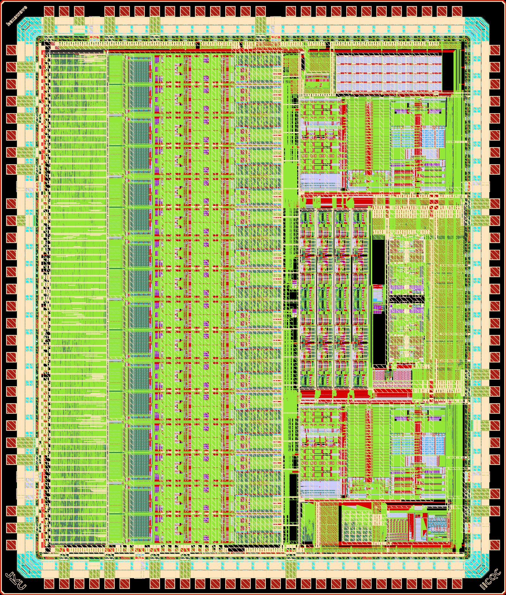

# SoC9876

Mixed-signal test chip in IHP SG13CMOS5L (130 nm CMOS), die 3657 x 4292 um, designed with open-source tools.

## Contents

- Digital core with SPI slave and register map: 16 direct digital synthesis (DDS) sine generators (32-bit phase accumulator, CORDIC) at 50 MHz, one per channel, and a control bus to the analog blocks.
- 16 analog channels, each with an 8-bit current-steering DAC, a trimmable active low-pass filter and a programmable gain stage.
- 16-input analog multiplier tree with a bandgap reference.
- Two 12-bit SAR ADCs with input multiplexers and measurement buffers for on-chip observation of internal nodes.
- Trimmable reference current generators.
- Test structures: a digitally controlled oscillator in a PLL clock multiplier and a stand-alone OTA.
- On-chip decoupling capacitors, per-domain ESD clamps and an IHP IO pad ring.

## Repository

- `release/v.1.0.0/gds/SoC9876.gds.gz`: release GDS (single top cell `SoC9876`, seal ring and metal fill included)
- `release/v.1.0.0/netlist/SoC9876.cdl.gz`: full-chip CDL at transistor level, top `.SUBCKT SoC9876`
- `release/v.1.0.0/doc/`: IHP precheck result, minimum DRC database and LVS report
- `doc/Datasheet.md`, `doc/Specification.md`: pinout, supplies, limits, power-up, board rules and interface, key figures per block
- `doc/info.json`: submission metadata
